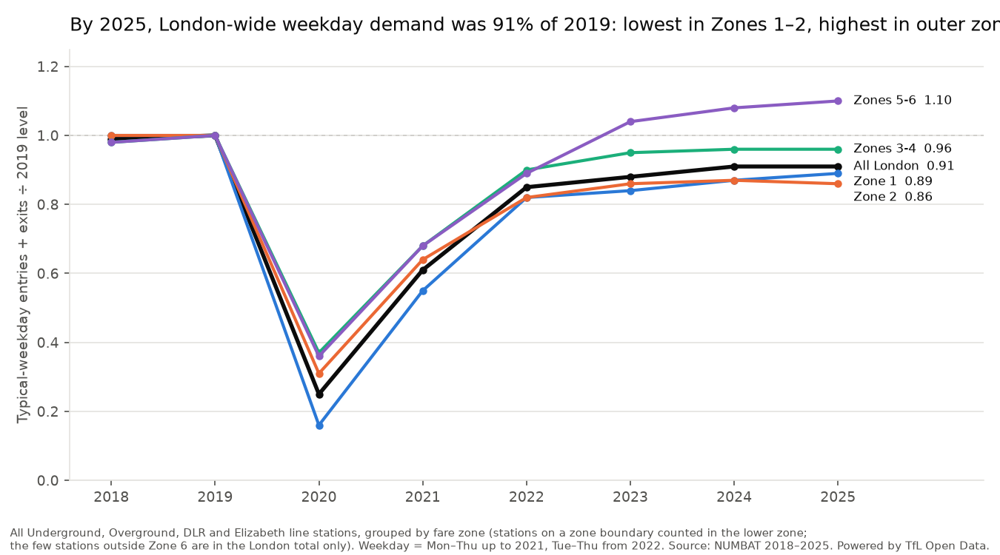
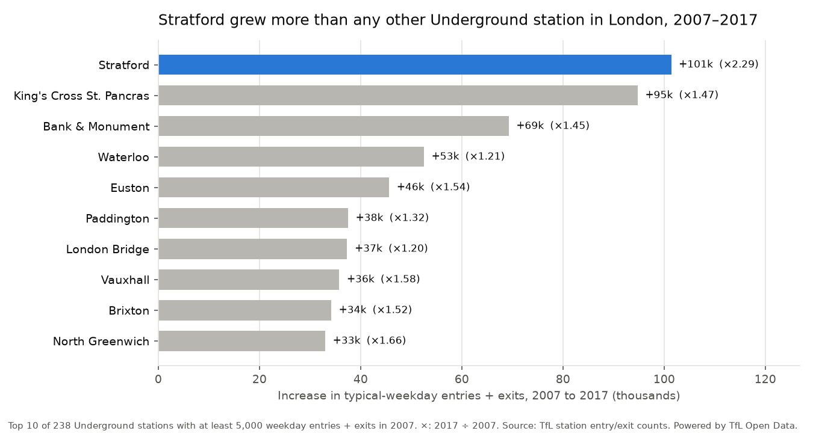
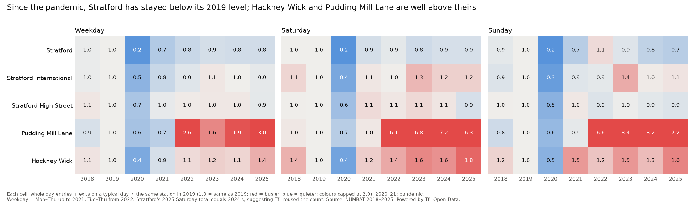
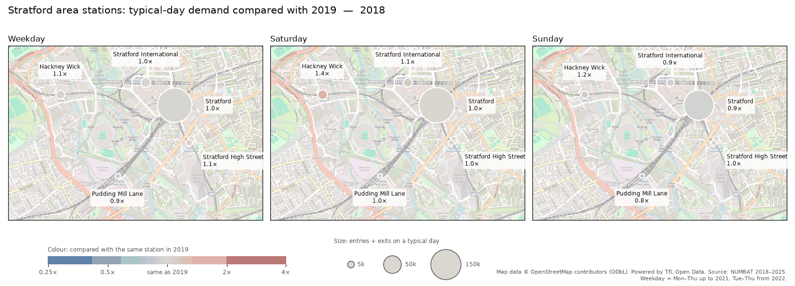
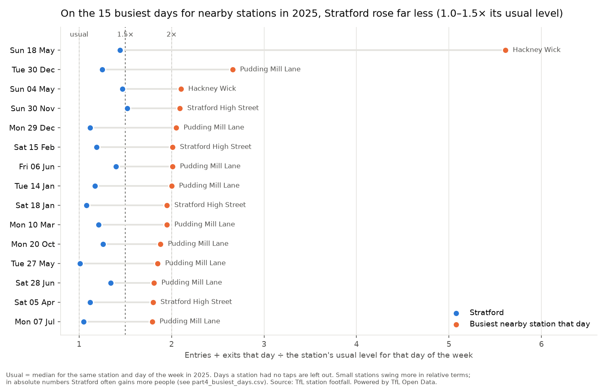

# When Does Concentration Become Pressure?
### Urban Mobility and Quality of Life in London: the case of Stratford

## The question

New transport links and new destinations attract people. But when demand grows faster than stations and trains can handle, travel gets worse, and the pressure may move to nearby places.

We first look at London as a whole, then test the idea at **Stratford** in east London, where new rail links, Westfield, the 2012 Olympics and London Stadium have brought large numbers of people to one area.

## The story

| Part | Question | Hypothesis | Status |
|---|---|---|---|
| 0. London overview | Where in London has demand grown, and how has it changed? | Context | First result |
| 1. Concentration | How did use of Stratford grow, and when? | H1 | First result |
| 2. Everyday pressure | How has demand changed at Stratford and four nearby stations? | H1, H2 | First result |
| 3. Travel experience | What does peak-hour crowding feel like on board? | H2 | First result |
| 4. Redistribution | On event days, does pressure move to smaller stations? | H3, H4 | First result |

### Part 0: London overview

**London as a whole.** Across all Underground stations, typical-weekday entries + exits grew by 22% between 2007 and 2017. More recently, weekday entries + exits across the whole network fell to 25% of the 2019 level in 2020 and reached 91% by 2025. Change was uneven across London: in 2025, Zones 1 and 2 were furthest below 2019 (0.89 and 0.86), while Zones 5–6 were above it (1.10).

**Where growth concentrated.** Growth was not spread evenly between stations either. Of 238 Underground stations, Stratford had both the largest increase in typical-weekday entries + exits between 2007 and 2017 (+101,000) and the largest growth rate (×2.29, against 22% for London). This is why we look at Stratford in detail in Parts 1–4.

### Part 1: Concentration

Typical-day use of Stratford Underground station, London's fastest-growing, more than doubled between 2007 and 2017. The largest jump came between 2010 and 2011, the year Westfield Stratford City opened.

### Part 2: Everyday pressure

On a typical day in 2025, Stratford is still below its 2019 level (about 0.7–0.9×), while Hackney Wick is well above (1.4–1.8×). Pudding Mill Lane jumps from 2022, but the cause still needs checking (see `docs/data.md`).

The same data on a map, year by year (circle colour = compared with 2019, circle size = number of people). An interactive version, where you can choose the year and day type, is in [`docs/part2_map.html`](docs/part2_map.html) (download it and open it in a browser).

### Part 3: Travel experience

On a typical 2025 weekday between 08:00 and 09:00, Central line and Elizabeth line trains leaving Stratford for central London run with all seats taken. Using a recent London crowding valuation (Yap, Wong & Cats 2023), a 10-minute ride feels like about 16 minutes on the Central line and about 24 minutes on the Elizabeth line, against 10–11.5 minutes off-peak. With the average of earlier studies, the figures are about 13 and 17 minutes. The Jubilee line starts at Stratford and has seats available on average.

### Part 4: Redistribution

On the 15 days of 2025 when a nearby station was busiest compared with usual, the nearby station reached 1.8–5.6× its usual level, while Stratford rose to only 1.0–1.5×. The most extreme day was Sunday 18 May, the day of the Hackney Half Marathon: Hackney Wick had 5.6× its usual Sunday use. In absolute numbers, though, Stratford still took more extra people that day (about 51,000 against 39,000 at Hackney Wick).

## Hypotheses

- **H1 — Concentration:** Improved access or new facilities are associated with increased local flows.
- **H2 — Pressure turning point:** Once seats are full, crowding makes travel feel sharply worse.
- **H3 — Redistribution:** When the hub is under pressure, demand shifts to nearby stations.
- **H4 — Management spillovers:** Crowd management at the hub may relieve it while increasing pressure elsewhere.

## Repository guide

| Folder / file | What it contains |
|---|---|
| [`docs/research_design.md`](docs/research_design.md) | Research question, case selection, methods and limitations |
| [`docs/data.md`](docs/data.md) | Data sources and licences, how the data are processed, and what each table contains |
| [`data/README.md`](data/README.md) | How to get the data and run the scripts |
| `src/` | Six scripts, run in order: `1_clean_numbat.py`, `2_clean_entry_exit.py`, `3_clean_footfall.py`, `4_make_tables.py`, `5_make_figures.py`, `6_make_map.py` |
| `data/events_calendar.csv` | Events near the Park, compiled by the team |
| `figures/` | Figures used in this README and the presentation |

## Responsible data analysis

- The crowding valuation in Part 3 comes from a published study; we apply it, we do not re-estimate it (see `docs/data.md`, section 5).
- Passenger counts are not direct measures of well-being, crowd density or safety.
- NUMBAT data are modelled typical days, averaged across all trains in each period.
- Thresholds used in the analysis are analytical choices, not safety limits.
- Patterns in time are associations, not proof of cause.

## Data attribution

Powered by TfL Open Data. Contains public sector information licensed under the Open Government Licence v2.0.
