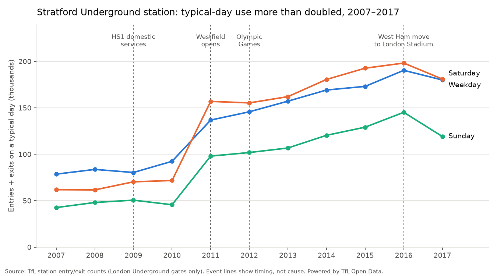
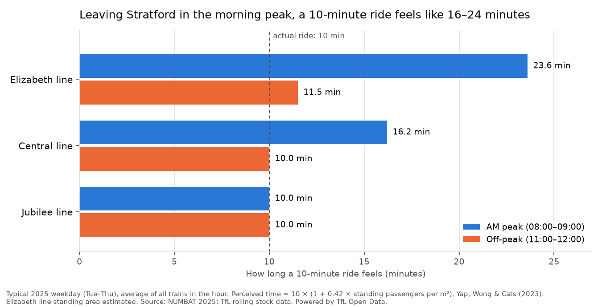

# When Does Concentration Become Pressure?
### Urban Mobility and Quality of Life in London: the case of Stratford

## The question

New transport links and new destinations attract people. But when demand grows faster than stations and trains can handle, travel gets worse, and the pressure may move to nearby places.

We test this idea at **Stratford** in east London, where new rail links, Westfield, the 2012 Olympics and London Stadium have brought large numbers of people to one area.

## The story in four parts

| Part | Question | Hypothesis | Status |
|---|---|---|---|
| 1. Concentration | How did use of Stratford grow, and when? | H1 | First result |
| 2. Everyday pressure | Is demand rising across Stratford and four nearby stations? | H1, H2 | In progress |
| 3. Travel experience | What does peak-hour crowding feel like on board? | H2 | First result |
| 4. Redistribution | On event days, does pressure move to smaller stations? | H3, H4 | Data being collected |

### Part 1: Concentration

Typical-day use of Stratford Underground station more than doubled between 2007 and 2017. The largest jump came between 2010 and 2011, the year Westfield Stratford City opened.

### Part 3: Travel experience

On a typical 2025 weekday between 08:00 and 09:00, trains leaving Stratford for central London run with all seats taken. Using a published London crowding valuation, a 10-minute ride feels like about 16 minutes on the Central line and about 24 minutes on the Elizabeth line, against 10–11.5 minutes off-peak. The Jubilee line starts at Stratford and has seats available on average.

_Parts 2 and 4 will be added once the multi-year NUMBAT data and the daily station footfall data are in place._

## Hypotheses

- **H1 — Concentration:** Improved access or new facilities are associated with increased local flows.
- **H2 — Pressure turning point:** Once seats are full, crowding makes travel feel sharply worse.
- **H3 — Redistribution:** When the hub is under pressure, demand shifts to nearby stations.
- **H4 — Management spillovers:** Crowd management at the hub may relieve it while increasing pressure elsewhere.

## Repository guide

| Folder / file | What it contains |
|---|---|
| [`docs/research_design.md`](docs/research_design.md) | Research question, case selection, methods and limitations |
| [`docs/data.md`](docs/data.md) | Data sources and licences, how the data are processed, and what each table contains |
| [`data/README.md`](data/README.md) | How to get the data and run the scripts |
| `src/` | Four scripts, run in order: `1_clean_numbat.py`, `2_clean_entry_exit.py`, `3_make_tables.py`, `4_make_figures.py` |
| `figures/` | Figures used in this README and the presentation |

## Responsible data analysis

- Passenger counts are not direct measures of well-being, crowd density or safety.
- NUMBAT data are modelled typical days, averaged across all trains in each period.
- Thresholds used in the analysis are analytical choices, not safety limits.
- Patterns in time are associations, not proof of cause.

## Data attribution

Powered by TfL Open Data. Contains public sector information licensed under the Open Government Licence v2.0.
